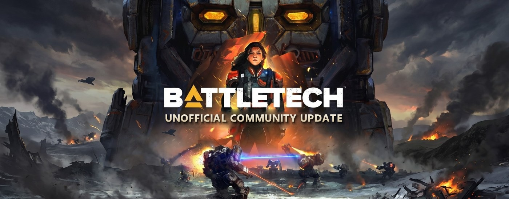
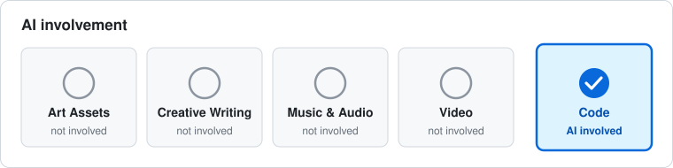
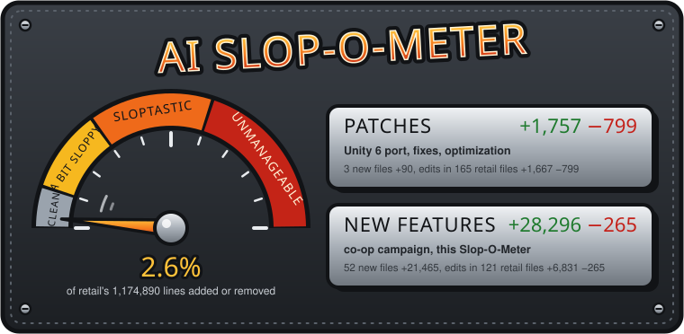

# BattleTech: Unofficial Community Update (UCU)

A (lowercase h) harebrained scheme to port (uppercase) Harebrained Schemes' [*BATTLETECH*](https://www.paradoxinteractive.com/games/battletech) (2018; launched on Unity 5.6, on Unity 2018.4 since 2019) and all DLC to Unity 6. It adds campaign/career co-op, faster loading and several bugfixes. Retail release (Steam only at the moment) is required to run it.

## Disclaimers

This project is a personal, non-commercial effort and is not affiliated with Paradox Interactive or Harebrained Schemes. It operates with permission from Paradox Interactive under their User Generated Content policy, but is not endorsed or supported by Paradox and they are not responsible for modified installs of their product.

**This is a beta, work-in-progress release.** It is maintained by volunteers. Please be patient.

## Support

**BUGS**: Use the Issues link on this repository.

**FEEDBACK/DISCUSSION**: We have a discord at https://discord.gg/tbmrmQzpvd -- please be patient!

## Current Release

**Version 2.1.0-2B**. Version definitions have to stick to the numbering system retail used, which is a little complicated:

- **2**: Major release: 2.0 is defined as Unity 6-built feature parity with retail and its DLC along with bugfixes, optimizations, and the multiplayer changes below.
- **1**: Minor release with new features or requirements, non-breaking changes backwards compatible within the major release line.
- **0**: Patchlevel: Bugfixes or minor corrections to the previous minor release.
- **2B**: Build number and (A)lpha/(B)eta/(R)elease indicator. 

The initial 2.0.0A line represented the development cycle from April 2026 to November 2026. Beta 1 was released publicly on November 13, 2026.

## Linux and MacOS

Beta 1 is Windows-only. We are aiming for Linux support (Proton) for Beta 2 - this is currently under investigation. Native Linux is more work but theoretically possible.

MacOS is harder as I have no Mac hardware available for it. This will depend on somebody in the community who does coming on board, or my getting access to a gaming Mac.

## What's different from the 2018 retail game (and what isn't)

- **Campaign/Career multiplayer.** Retail multiplayer is skirmish-only and relied on multiplayer servers long since sunset (without mods). In 2.0, career and campaign mode support the host inviting up to three other players and assigning permissions for each guest (mech bay, store, hiring, barracks, etc). Everyone sees the Argo, and each player controls the 'Mechs assigned to them. On a mission with fewer 'Mechs than players, anyone not assigned to a 'mech is an observer.
- **Faster loading.** A career save loads in about 17 seconds, down from 29 to 36 in our tests. A heavily modded save loads about a fifth faster.
- **Retail bugs fixed.** Including multiplayer deadlocks, mortar strikes that lost their targets or fired twice on other players' screens, and more.
- **Direct3D 12 is available.** This is a course for future development: D3D12 offers no performance or visual benefit for players (yet). Start the game with `-force-d3d12` to switch. 
- **Mods still work.** ModTek and Harmony mods run with no rebuild. A BattleTech Advanced career has been played through a contract, salvage, and a save and reload, but additional testing is required.
- **Content is unchanged.** If we didn't have to change something to make it work in Unity 6 or with multiplayer, we didn't, other than bugfixes and optimizations.
- **Paradox Online Services.** Paradox accounts work as in retail. Some analysis telemetry (app launch, hardware info) is sent to Paradox in retail but some of it was being rejected. We kept what was being accepted and disabled what was being rejected.

See the [CHANGELOG](CHANGELOG.md) for the full list.

2.0 is backward-compatible with retail saves. Multiplayer doesn't connect to retail 1.9.1 players. 

## Installing and Running BattleTech: Unofficial Community Update

Releases are packaged into an installer which has several layers of validation (so you must be online for the install):

- The installer validates that you own Battletech (retail) through Steam's API and issues a BT-UCU key based on that validation. That is used to download and decrypt the update.
- Running the installed game validates that you own it on Steam (and multiplayer requires separate copies -- you can run the game from a shared family library, but only one player in any session can use that copy)

The downside to all this validation is that you end up with double the normal install size (the original retail install remains untouched, and then UCU installs in its own location). You can safely remove the original retail install after UCU is installed, but you'd just need it back again for UCU updates. There is no way around this unless Paradox wants to adopt us, and we're not holding our breath!

Updates to BT-UCU will update the installed folder in place. To uninstall, simply delete the folder. 

## Playing BattleTech Advanced (BTA) on UCU

From 2.1.0-2B, UCU can run mods through ModTek, including the BattleTech Advanced pack. BTA's own installer needs retail BATTLETECH 1.9.1 and won't install onto UCU, so you install BTA on retail as usual and then copy it across with Link BTA.

1. **Install BTA on your retail game** the way its authors describe, and start it once.
2. **Install UCU with mod support on.** The installer has a *Mod support* box under "Install to", ticked by default. It puts the mod loader beside `BattleTech.exe`; without a `Mods` folder, UCU starts exactly as it does unmodded. Start UCU once.
3. **Run Link BTA.** Open the `ModSupport` folder inside your UCU install and double-click `Link BTA.cmd`. It finds both installs in your Steam libraries and asks about any it can't find (or drag your BTA folder onto it). It copies BTA's `Mods` folder (plus `Mods_sfx` and `Music`) and your BTA saves into UCU. Your BTA install is only read. UCU's drive needs about 20 GB free for this.
4. **Start UCU as usual.** The first start is slow while ModTek builds its cache.

Good to know:

- **After a BTA update**, run Link BTA again. UCU's `Mods` folder is re-synced to match BTA's, so add mods to BTA, not to UCU's copy.
- **Saves:** a BTA career carries over. On a re-run, a save you made in UCU is kept, not replaced by an older BTA one. To skip saves, run `Link BTA.cmd -NoSaves`.
- **Leave a mod out:** `Link BTA.cmd -Skip ModName`.
- **Back to unmodded UCU:** `Link BTA.cmd -Unlink` removes the copied mods. Your saves stay.
- **Mods didn't load?** Open `BattleTechPortBootstrap.log` beside `BattleTech.exe` and attach it to your bug report with `Player.log`. A good run ends with `done|retargeted=5`.
- Link BTA won't run while UCU is open, if the drive is too full, or if it finds a `Mods` folder it didn't make. It writes nothing until those checks pass.

## Who I am, and why this project

This project began as a thought experiment of 'I wonder whether this is possible' and turned into a full-blown update of the game to Unity 6.

I'm InternetDadCo, the founder and principal architect at a software company that does not, on a typical day, involve giant robots. In the Spring of 2026, we were in the midst of the transformation of the software sector from 'sometimes AI assisted' to 'AI-driven, human supervised' -- but we're all aware that this transition is not without its obstacles, and I wanted to experiment on my own time with different models and harnesses to learn their strengths, weaknesses, and limitations. 

At the same time, my son was getting into the 2018 Battletech game, and he wanted to know why we couldn't play the campaign together, since multiplayer was only supported in skirmish mode. I knew very little about Unity -- the little game development experience I had came from MUSHes in the early 2000s -- but I thought it would be a fun exercise to dig into the retail release and see what it would take to give Harebrained's fantastic 2018 game a little 2026 update, since the barrier to doing so these days is a lot lower than it was a year ago.

### A note on AI

The below is a brief statement about AI usage in this project. For more detail, see our [Note on AI](NOTE-ON-AI.md) and if you have specific questions, we will address them there.

There is an avalanche of AI slop projects. Built into the DNA of our project's mission is that we retain the discipline and focus to avoid that label. On the one hand, this project represents exactly the kind of effort that wasn't viable before AI; there's not enough money or other incentive for any of the commercial entities concerned to have undertaken it. But just because you can doesn't mean you should. 

Retail's own code is over a million lines.  We didn't want to fix what wasn't broke. 'Patches' counts changes we've made to retail code to bring it forward into Unity 6, fix a bug, or improve performance. New features are limited to multiplayer career/campaign mode.

I am a software developer with more than two decades of experience, but the folks at Harebrained and Paradox have more understanding of how these things work in their pinky fingers than I do. I'm a generalist but not a Unity developer, and I had to develop a rudimentary enough understanding of the Unity engine to know how to direct the AI and to evaluate whether it could achieve parity with a very mature, battle-tested retail release. Progress was very slow at first, but once we were able to get the UI off the ground, the rest followed.

AI made this project possible. AI can also ruin it. That's why we maintain the slop-o-meter and why the majority of our effort goes into bugfixes, fidelity with the original game, and the narrow scope of 'new stuff' that we've accepted. Battletech has a superb modding community and it's the folks over at [BTA](https://www.bta3062.com/) and [RogueTech](https://roguetech.fandom.com/) and elsewhere who keep interest in this title alive. 

Nobody wants new releases with breaking changes or significant alterations to features every couple of days; but we wouldn't be here at all but for AI labor. If you disagree, that's cool, I respect your artisanal cheese-making and butter-churning! But in our house, we had giant robots to blow up and that was only going to happen with some help.

## Project Status

The update is playable and (we hope) most of what's needed now is attention on some of the fiddly bits that a dedicated group of players will find in no time -- especially on career multiplayer. We've tested a lot, and at this point we need to stop and make sure the project has legs: if it does, we'll turn this into a community-driven beta since you all can test a lot better than any harness. What we have done is a lot of comparison and playthroughs to make sure that behavior matches retail and things draw properly.

We've also maintained mod support and loaded Battletech Advanced, but we need the community's help doing playthroughs and testing other mods.

## Known issues

Places where the port means to match retail but doesn't quite yet. Deliberate changes are in [CHANGELOG.md](CHANGELOG.md).

- **Ground around large rocks** is about 5% darker than retail's, because the rocks block bounced light without bouncing any of their own.
- **Urban maps:** Metro Green's light probes come out 7-8% brighter than retail's, and the bounce near its highway is warmer.
- **Martian maps** look less red and less saturated than retail's, and their rocks show more contrast. This was measured at different times of day and isn't confirmed yet.
- **Most maps** haven't been compared with retail side by side under the same weather, and decals have been measured only on Central Mountain and Still Valley.
- **Portraits** read slightly darker than retail, mostly on the shaded side of the face, and one preset's hair tips look cyan.
- **Linux and Steam Deck (Proton):** In 2.1.0-2B, the main menu's animated background shows colour bars (vertical stripes) instead of the video, because Proton can't play that video format. The menu works on top of it, and the opening cinematic and story cutscenes use a different format that plays. The small video screens on some Urban Warfare city maps will probably show colour bars too. Proton has only been tested as far as the main menu, on one Linux PC and not on a Steam Deck, and the game needs a working sound system (PulseAudio or PipeWire, which desktops and SteamOS have) or it closes at start-up. The videos are already converted to a format Proton plays; that fix comes in 2.1.1-2B.

## Visuals and lighting

Most of our effort went into making the game look the way it did in 2018, because that is the hardest part to check. Rules can be tested: give the port and retail the same inputs and the results must match. Pictures, less so. Skirmish weather is picked at random, clouds drift and the camera pans, so two screenshots only compare fairly on the same map, weather, moment and view, and someone still has to judge which differences matter. We've compared several maps closely, but not all of them in every weather.

Why the port can look different from retail:

- **Shaders** ship only as compiled code. We rebuilt each one from that code and check it against retail's, but a shader that failed to rebuild or load draws wrong.
- **Bounced light** (realtime GI) had to be baked again. Unity 6 couldn't bake retail's maps with retail's settings, so each map is rebaked from retail's own layout. It comes close to retail but isn't identical. Would you notice if we didn't tell you? Is it an issue? You tell us.
- **Textures and materials** went through Unity 6's importer, which changed defaults that retail relied on.

Signs of something we should know about:

- pink, magenta or bright cyan surfaces, which mean a shader failed;
- black, see-through or missing surfaces, or missing decals such as road markings, dust or snow;
- a tint retail doesn't have, such as lavender on building fronts;
- an area much darker or brighter than the scene around it, or than the same spot in retail, most often in shade or under cover;
- flickering, shimmering, or shadows that pop.

Small shifts of a few percent in brightness or colour are expected and listed below. If you report something, give the map, the weather and time of day, and a screenshot. A retail screenshot of the same spot in the same weather helps most, and the game's `Player.log` helps too. Visual issues get priority.

## Roadmap

Our priorities:

- **Mid-battle saves with mods.** Some mods make saving in the middle of a battle unreliable. We'd like to make it easier to get this working again.
- **Your feedback.** This has been our pet project for the last seven months; now it's up to you to put the 'UC' in this update.
- **Career and campaign co-op.** Since this is the flagship feature, we'd like to reduce any further barriers to people playing Battletech together!
- **Direct3D 12.** Still very much a 'maybe' but we'll be exploring the possibilities and ramifications.

## On the Installer and Verifying Source

We received some excellent feedback concerning our use of an installer whose source cannot be verified. We are incorporating this feedback and intend to release as much as we can in short order. It's a bit of a highwire act because we'd like our changes to be audit-able, but the thing we're changing is in some cases the HBS retail product and that is not ours to release (which is why the installer just copies retail content from your retail install - we're not distributing it.) Even so, as a public project, this effort is brand new and this is on the top of our list for Things That Need to Be Better, so give us a little bit to see what we can do!

## Credits

All of the original assets upon which this project is based come from, and belong to Harebrained Schemes and Paradox Interactive.

Battletech is a registered trademark of Microsoft Gaming and the Topps Company (licensed to Catalyst Game Labs). 

Finally, to Jack, for the idea and a reason to go to the trouble.